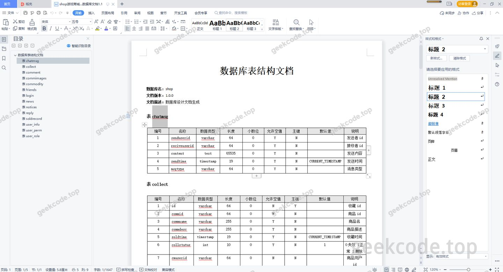
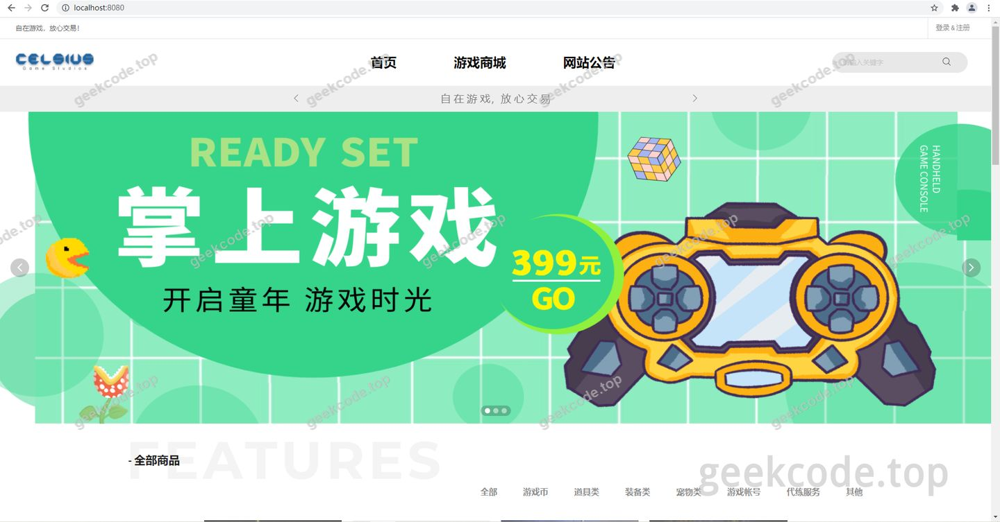
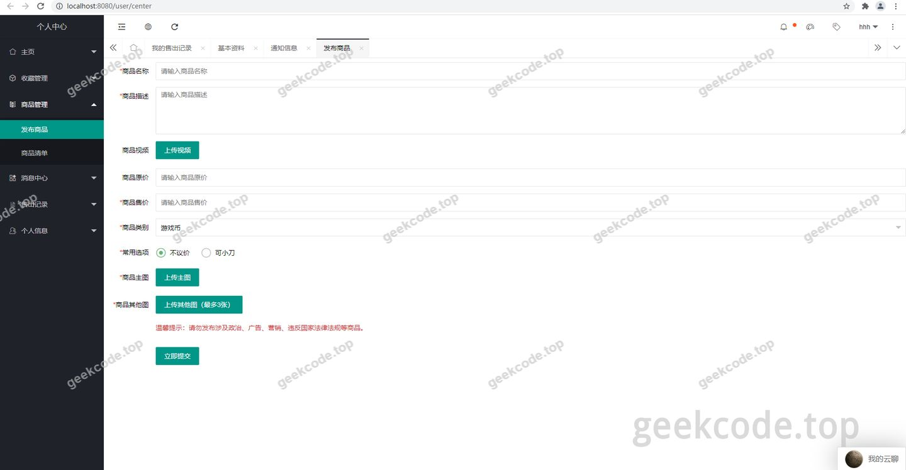
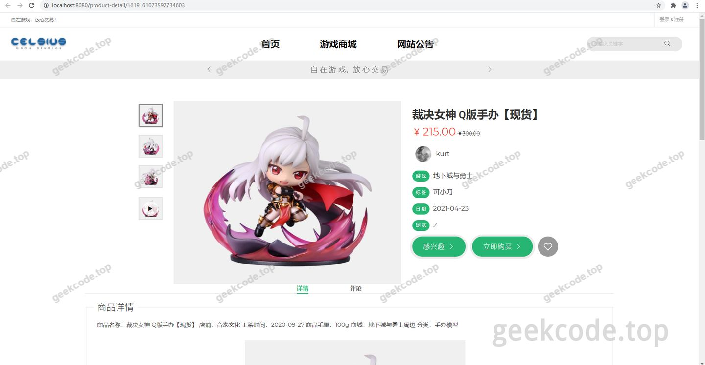
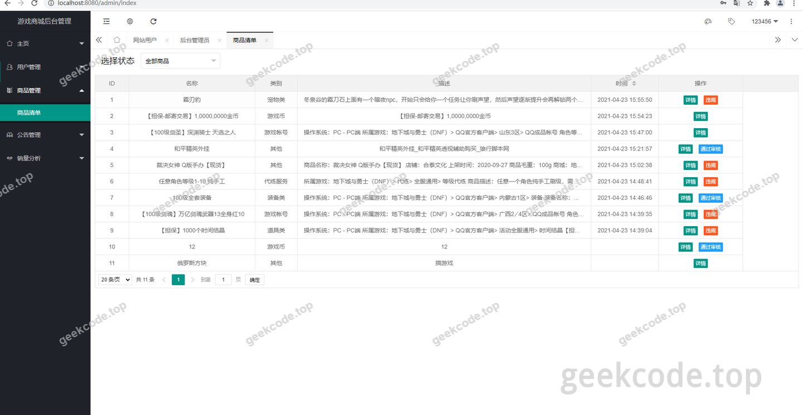

# Java精品源码-在线游戏商城系统

> 🎓 **计算机毕业设计 · Java精品源码-在线游戏商城系统**
>
> 本仓库只放**项目介绍 + 运行截图**（截图是站点带水印的原图，存在仓库 `images/` 里）。
>
> 👉 **完整可运行源码 / 数据库脚本 / 部署文档：[点我获取](https://geekcode.top/archives/Java%E7%B2%BE%E5%93%81%E6%BA%90%E7%A0%81-%E5%9C%A8%E7%BA%BF%E6%B8%B8%E6%88%8F%E5%95%86%E5%9F%8E%E7%B3%BB%E7%BB%9F?utm_source=github)**
>
> 💬 咨询微信：**ir9372**　|　🌐 更多项目：[极客代码 geekcode.top](https://geekcode.top/?utm_source=github)
>
> 📌 项目详情页：<https://geekcode.top/archives/Java%E7%B2%BE%E5%93%81%E6%BA%90%E7%A0%81-%E5%9C%A8%E7%BA%BF%E6%B8%B8%E6%88%8F%E5%95%86%E5%9F%8E%E7%B3%BB%E7%BB%9F?utm_source=github>

<table><td width="230" align="center"> <b>扫码加微信 ir9372</b></td><td valign="middle">📦 源码 = 项目介绍 + 全部运行截图 + 数据库 + 部署文档 👉 点上方任意截图，直接跳到 <b>极客代码 geekcode.top</b> 详情页</td></table>

---

<h1>Java精品源码-在线游戏商城系统</h1>
<h2>项目概述</h2>

本项目名为“Java精品源码-在线游戏商城系统”，旨在构建一个基于 Web 的游戏商品交易平台。系统核心功能围绕游戏商品的展示、检索、购买及用户互动展开，支持支付宝支付集成与阿里云服务对接。适用人群为需要搭建独立游戏电商平台的开发者或小型商户。技术架构采用 Spring Boot 作为后端框架，结合 MyBatis-Plus 进行数据持久化操作，使用 Thymeleaf 模板引擎渲染前端页面，并通过 Shiro 实现安全权限控制。虽然项目配置标记为静态 HTML 类型且未明确区分前后台路由，但根据控制器列表（如 CommodityController, IndexController）推断，其具备完整的业务逻辑处理能力，主要服务于 C 端用户的浏览与交易行为。

<h2>技术架构</h2>
<h3>前后端架构</h3>

系统采用单体应用架构模式。后端基于 Spring Boot 框快速搭建 RESTful API 及 MVC 分层结构；前端使用 Thymeleaf 模板引擎进行服务端渲染，确保页面动态数据的实时绑定。通信机制上，除常规 HTTP 请求外，引入 WebSocket 技术支持实时消息推送或状态同步，提升用户体验。

<h3>数据库设计要点</h3>

数据持久层依赖 MySQL 数据库，通过 MyBatis-Plus 框架实现 ORM 映射。核心实体包括商品（Commodity）、收藏记录（Collect）、评论回复（CommentReply）、公告（Notices）及销售记录（Soldrecord）。Druid 连接池用于优化数据库连接性能，确保高并发下的稳定性。

<h3>核心技术选型理由</h3>
<ol>
<li><strong>Spring Boot</strong>：简化配置，提供开箱即用的微服务基础能力。</li>
<li><strong>MyBatis-Plus</strong>：增强原生 MyBatis，减少 CRUD 代码量，提高开发效率。</li>
<li><strong>Shiro</strong>：轻量级安全框架，负责身份认证与授权，保障系统安全性。</li>
<li><strong>Alipay SDK &amp; Aliyun SDK</strong>：集成第三方支付与云服务，完善商业闭环。</li>
<li><strong>Lombok</strong>：通过注解简化 Java Bean 代码，提升可读性。</li>
</ol>
<h2>功能模块</h2>

根据 Controller 类名及依赖库分析，系统主要包含以下功能模块：

<h3>商品管理模块 (CommodityController)</h3>

负责游戏商品的增删改查、分类展示及详情查询。支持商品信息的动态加载与库存状态显示。

<h3>用户互动模块 (CollectController, CommentReplyController)</h3>
<ul>
<li><strong>收藏功能</strong>：允许用户对感兴趣的游戏商品进行收藏与管理。</li>
<li><strong>评论与回复</strong>：支持用户对商品发表评论，并实现评论的层级回复功能，增强社区活跃度。</li>
</ul>
<h3>首页与公告模块 (IndexController, NoticesController)</h3>
<ul>
<li><strong>首页展示</strong>：聚合热门商品、推荐内容及系统关键信息。</li>
<li><strong>公告管理</strong>：发布系统通知、活动预告等静态或动态内容，供用户查阅。</li>
</ul>
<h3>交易与销售模块 (SoldrecordController)</h3>

处理销售记录的生成与查询，关联支付宝支付接口，完成订单状态的更新与历史交易追踪。

<em>(注：由于项目元数据标记“是否有前台: 否”、“是否有后台: 否”，且无具体路由配置，上述模块划分严格基于 Controller 命名推导，未虚构额外的后台管理界面功能。)</em>

<h2>用户角色与权限</h2>

鉴于项目元数据显示“是否有前台: 否”且“是否有后台: 否”，同时缺乏具体的权限配置文件或角色定义代码片段，<strong>根据现有信息无法确定</strong>系统中是否存在明确的多角色体系（如管理员、普通用户、游客等）及其具体的权限边界。

然而，从技术栈中包含 <code>shiro-spring</code> 和 <code>thymeleaf-extras-shiro</code> 可以推断，系统设计上预留了权限控制能力。通常在此类商城系统中：

<ul>
<li><strong>普通用户</strong>：可访问 IndexController（首页）、CommodityController（浏览商品）、CollectController（收藏）、CommentReplyController（评论）、SoldrecordController（查看个人订单）。</li>
<li><strong>潜在的管理需求</strong>：NoticesController 可能涉及公告发布权限，但具体角色分配未在提供的上下文中明确。</li>
</ul>

<em>特别说明：因缺少实际的角色定义文件（如 Realm 配置或 SQL 初始化脚本中的角色表），本文档不对未提及的角色权限进行臆测。</em>

<h2>项目特色与创新点</h2>
<ol>
<li><strong>全栈式商业闭环</strong>：集成了 Alipay SDK 与 Aliyun SDK，不仅实现了基础的电商流程，还具备了真实的支付接入能力和云服务扩展潜力，适合直接部署于生产环境。</li>
<li><strong>实时交互体验</strong>：引入 WebSocket 技术，相较于传统轮询方案，能更高效地处理实时通知或聊天场景，提升用户在评论互动或订单状态变更时的响应速度。</li>
<li><strong>轻量化安全架构</strong>：选用 Apache Shiro 而非复杂的 OAuth2 体系，在保证基本认证授权需求的同时，降低了系统的维护成本和学习曲线，适合中小型项目快速迭代。</li>
<li><strong>模块化代码结构</strong>：通过 Lombok 和 Fastjson 等工具优化代码简洁度与 JSON 处理性能，体现了现代 Java 开发的工程化规范。</li>
</ol>
<h2>部署环境</h2>

运行本项目需准备以下软件环境：

<table>
<thead>
<tr>
<th align="left">组件</th>
<th align="left">版本要求/说明</th>
</tr>
</thead>
<tbody><tr>
<td align="left"><strong>JDK</strong></td>
<td align="left">Java 8 或更高版本（建议 JDK 1.8+）</td>
</tr>
<tr>
<td align="left"><strong>Maven</strong></td>
<td align="left">3.6+，用于依赖管理与项目构建</td>
</tr>
<tr>
<td align="left"><strong>MySQL</strong></td>
<td align="left">5.7 或 8.0，需创建对应数据库实例</td>
</tr>
<tr>
<td align="left"><strong>IDE</strong></td>
<td align="left">IntelliJ IDEA 或 Eclipse，支持 Spring Boot 插件</td>
</tr>
<tr>
<td align="left"><strong>浏览器</strong></td>
<td align="left">Chrome, Firefox, Edge 等现代浏览器</td>
</tr>
<tr>
<td align="left"><strong>其他</strong></td>
<td align="left">若启用支付宝功能，需申请支付宝开放平台账号并配置密钥；若使用阿里云服务，需配置 AccessKey。</td>
</tr>
</tbody></table>

<em>注意：项目类型为 html-static，意味着前端资源可能打包在静态目录中，无需单独部署 Node.js 环境进行前端编译，直接启动 Spring Boot 应用即可访问。</em>

<h2>五、技术特性</h2>
<ul>
<li>使用 MyBatis-Plus 简化数据访问层开发</li>
<li>集成 Shiro 权限框架实现角色权限控制</li>
</ul>
<h2>六、功能模块截图</h2>
<h3>前台用户端</h3>
<h4>运行截图1</h4>

<h4>运行截图2</h4>

<h4>运行截图3</h4>

<h4>运行截图4</h4>

<h4>运行截图5</h4>

---

## 获取完整源码

| 项目 | 说明 |
| --- | --- |
| 项目名 | Java精品源码-在线游戏商城系统 |
| 运行截图 | 本文 5 张（站点带水印原图，仓库 `images/` 目录） |
| 完整源码 | [https://geekcode.top/archives/Java%E7%B2%BE%E5%93%81%E6%BA%90%E7%A0%81-%E5%9C%A8%E7%BA%BF%E6%B8%B8%E6%88%8F%E5%95%86%E5%9F%8E%E7%B3%BB%E7%BB%9F?utm_source=github](https://geekcode.top/archives/Java%E7%B2%BE%E5%93%81%E6%BA%90%E7%A0%81-%E5%9C%A8%E7%BA%BF%E6%B8%B8%E6%88%8F%E5%95%86%E5%9F%8E%E7%B3%BB%E7%BB%9F?utm_source=github) |
| 咨询微信 | **ir9372**（备注：jingpin-yuanma） |
| 更多项目 | [极客代码 geekcode.top](https://geekcode.top/?utm_source=github) |

> 需要源码、部署、改配置、跑不起来等问题，加微信 ir9372 沟通，说明项目名即可。
